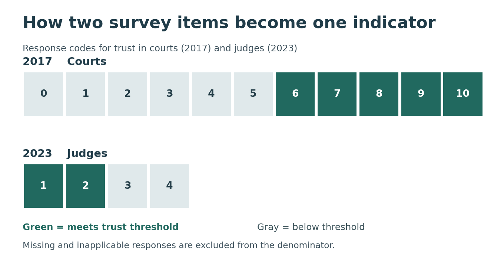

# Judicial trust in two waves of the Chinese General Social Survey

**LI Siwei · Pair project · Shared methods for CISC7204 Assignments 01 and 02**

Our two-person project asked how responses about judicial trust differed between the 2017 and 2023 surveys, and how those responses varied by household economic standing and birth cohort. The question changed between waves. In 2017 respondents rated courts on an eleven-point scale. In 2023 they rated judges on a four-point scale, in the face-to-face questionnaire. Choosing a common coding rule lets us compare responses while keeping those measurement differences visible.

My Python work translated the 2023 cleaning rules, combined the survey waves and checked the results against the project's Stata files. This page documents that part of our joint project, *From Courts to Judges, from Eleven Points to Four: Harmonizing and Modeling Two Waves of Judicial Trust in the Chinese General Social Survey*.

## How we coded the outcome



| Survey item | Valid answers | Answers coded as trusting |
| --- | --- | --- |
| 2017 courts, `c121` | 0 to 10 | 6 through 10 |
| 2023 judges, `c17p` | 1 to 4 | 1 or 2 |

A skipped question cannot tell us whether the respondent trusted judges. The cleaning code keeps these responses missing. In the supplied pooled Stata reference, some missing 2023 answers had become zeros. Correcting that difference preserves the denominator of respondents who gave a valid answer.

## From survey files to figures

1. **Clean the 2023 wave.** `clean_cgss.py` reads an authorized raw Stata file, handles invalid and inapplicable codes, derives analysis variables and writes a local audit log. It also supports checks against the project's reference files. For 2017 the Python workflow starts from the project's already-cleaned Stata reference and converts it to CSV. The raw 2017 file was unavailable in this workflow.
2. **Combine the waves.** `build_pooled.py` checks identifiers within survey year, appends rows, normalizes the weights within each year and computes income groups within year. The local 2023 file lacked a survey-weight field, so the original workflow assigned equal weights in that wave.
3. **Compare groups.** `analyze.py` can calculate the proportion meeting the trust threshold for each year and each self-rated economic category, with approximate intervals based on the effective sample size. For birth cohorts, it calculates unweighted sample proportions with Wilson intervals. The private output contains a group summary and two charts.
4. **Compare provinces across waves.** In the visualization work for Assignment 02, `regional_trust_scatter.py` pairs the unweighted provincial rates where both waves have valid answers. Each axis represents one wave. Distance from the diagonal shows the direction and size of the descriptive difference.
5. **Calculate adjusted predictions.** `internet_trust_adjusted_predictions.py` fits the project's weighted linear probability model on complete cases. For each of the five internet-use levels it sets that level for every observation, holds the other observed covariates fixed and averages the predictions using the model weights. The covariates include year, cohort, education, household registration, economic standing, region and employment status. The script calculates cluster-robust intervals using the project's `s42c` codes.

The surveys interviewed separate samples. Item wording, response scales, mode of interview and the composition of the two samples can all affect the observed differences. The intervals in these descriptive figures do not account for the full multistage survey design.

The adjusted model treats the five ordered internet-use categories as equally spaced. An association between internet use and reported trust can reflect unmeasured differences between respondents. The project's `s42c` field copies the supplied cluster identifier. Negative or repeated codes across waves need a survey-design audit before using these intervals for population inference.

## Reproduce the public coding guide

Run these commands from this directory in an active Python 3.10 environment. The figure uses only the two coding rules and requires no data download.

```sh
python -m pip install -r requirements.txt
python analyze.py
```

## Reproduce the empirical analysis privately

The commands below use an example private directory outside the repository. Obtain the survey files through your own authorized access. The 2017 input is the compatible, already-harmonized team reference described above. Researchers using raw 2017 data must first construct the harmonized columns.

```sh
python clean_cgss.py --raw-2023 C:/cgss-private/CGSS2023.dta --reference-2017 C:/cgss-private/CGSS2017a.dta --output-dir C:/cgss-private/results
python build_pooled.py --cleaned-2017 C:/cgss-private/results/CGSS2017_cleaned_reference.csv --cleaned-2023 C:/cgss-private/results/CGSS2023_cleaned_python.csv --output-dir C:/cgss-private/results
python analyze.py --pooled C:/cgss-private/results/CGSS2017_2023_pooled_python.csv --output C:/cgss-private/results
python regional_trust_scatter.py --input C:/cgss-private/results/CGSS2017_2023_pooled_python.csv --output-dir C:/cgss-private/results
python internet_trust_adjusted_predictions.py --input C:/cgss-private/results/CGSS2017_2023_pooled_python.csv --output-dir C:/cgss-private/results
```

When available locally, supply `--reference-2023` and `--pooled-reference` to the cleaning script and `--reference` to the pooling script to run the original Stata comparison checks. The full sequence was rerun against the project files for this release. Counts, proportions and intervals for economic standing and cohort matched the saved notebook at the precision of the exported table. Provincial counts and rates, model predictions, standard errors and interval endpoints were also checked against the saved numeric outputs. The public coding guide was regenerated independently and matched the published image byte for byte.

## Data and acknowledgments

The data come from the Chinese General Social Survey (CGSS), conducted by the National Survey Research Center at Renmin University of China. We thank the Center and its staff for making the survey possible. The project authors take responsibility for the analysis and interpretation. The public materials contain code and a coding diagram. The archive requires individual registration, limits sharing of the data and asks authors to notify the provider and supply an electronic copy of published research outputs. [CGSS 2017](https://www.cnsda.org/index.php?r=projects/view&id=94525591) · [CGSS 2023](https://www.cnsda.org/index.php?r=projects/view&id=11256439) · [Archive data-use agreement](https://www.cnsda.org/doc/CNSDA_DataUseAgreement.html)

OpenAI Codex assisted with preparing the public scripts, drawing the coding guide, drafting the documentation and checking the rerun against the saved analysis.
