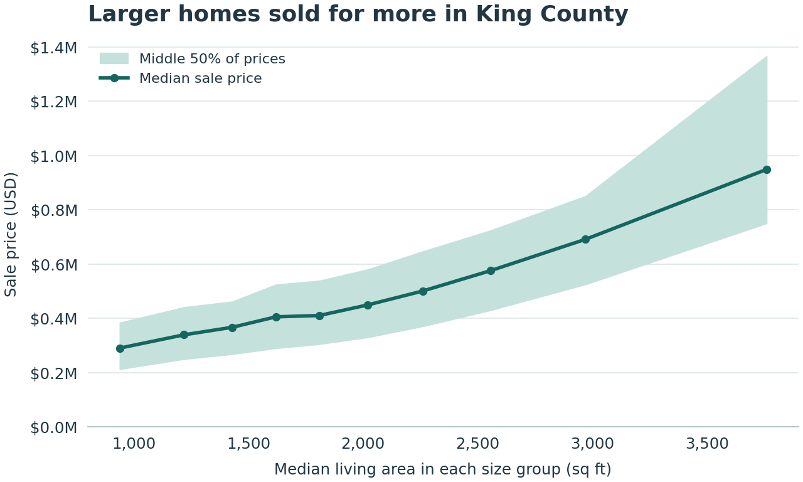
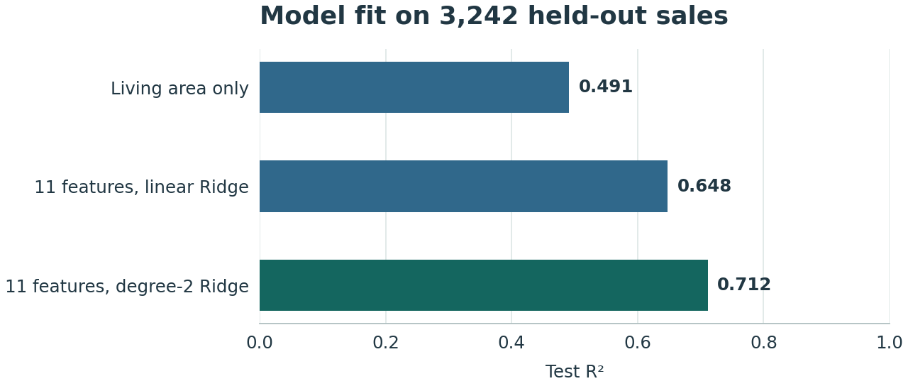

# King County house sales

**LI Siwei · CISC7204 Assignment 01 · Completed**

How much does living area tell us about the price of a King County home, and how much do other property features add? I used 21,613 sales from May 2, 2014 to May 27, 2015 to compare three models on the same test transactions.

## What the data show

The typical home in the smallest tenth of sales by living area had 940 sq ft. The median sale price in that group was $290,000. In the largest tenth, the corresponding medians were 3,760 sq ft and $948,000. Prices also varied widely within each size group. In the largest group, the middle half ranged from $750,000 to $1,365,000.



The chart uses all sales. Each point pairs the group's median living area with its median price. Homes with the same recorded area stay together, so the ten groups differ slightly in size.

| Model | Test R² | Mean absolute error (USD) |
| --- | ---: | ---: |
| Living area only, ordinary least squares | 0.491 | $174,799 |
| 11 features, linear Ridge | 0.648 | $135,857 |
| 11 features, degree-2 Ridge | 0.712 | $118,490 |



Adding property features reduced the average absolute error by about $39,000 per sale. Adding squared terms and interactions reduced it by another $17,000. The most flexible model still missed the sale price by about $118,000 on average.

## Method and limits

The original assignment used a random 85/15 split with seed 1. This script keeps that split of 18,371 training sales and 3,242 test sales. The baseline uses living area alone. The other models use floors, waterfront status, latitude, bedrooms, basement area, view rating, bathrooms, the supplied nearby-home living-area measure (`sqft_living15`), above-ground area, grade and living area. Property IDs only appear in the repeated-sales check.

The course file has 13 missing bedroom counts and 10 missing bathroom counts. Both Ridge pipelines estimate means and standardization parameters from training rows only. Each uses a penalty of 0.1. The degree-2 pipeline adds squares and pairwise interactions after standardization. Test R² compares squared errors with the variation around the test-set mean price. Mean absolute error gives the average prediction error in US dollars, regardless of direction.

The records cover one county and roughly one year. Unmeasured differences in location or condition can also explain price differences between size groups. A random split mixes dates, and 38 property IDs occur on both sides. A next check would reserve later sales for testing and exclude their properties from training. The reported scores support comparisons within this sample.

## Coursework and sources

I completed the ten questions in the IBM Skills Network lab *House Sales in King County, USA* for CISC7204 Assignment 01. My submitted notebook examined missing values, compared sale prices and fitted linear, polynomial and Ridge models. The lab credits Joseph Santarcangelo, Michelle Carey and Mavis Zhou and carries an IBM copyright notice. This portfolio edition contains a newly written Python script and two new aggregate figures. The saved notebook's degree-2 Ridge test R² was 0.700 with its original preprocessing. Training-only imputation and standardization in this edition give 0.712 on the same split.

The upstream Kaggle listing by **harlfoxem** labels the original data CC0. IBM Skills Network supplies the modified teaching CSV, including the missing values. This repository links to that course file and distributes aggregate results. Obtain the CSV from its host when reproducing the work. [Upstream dataset](https://www.kaggle.com/datasets/harlfoxem/housesalesprediction) · [Kaggle license metadata](https://api.kaggle.com/v1/datasets/view/harlfoxem/housesalesprediction) · [IBM Skills Network course CSV](https://cf-courses-data.s3.us.cloud-object-storage.appdomain.cloud/IBMDeveloperSkillsNetwork-DA0101EN-SkillsNetwork/labs/FinalModule_Coursera/data/kc_house_data_NaN.csv)

For this portfolio edition, OpenAI Codex assisted with the analysis script, figures, documentation and reproduction checks.

## Reproduce

With Python 3.10 and an active virtual environment, open a terminal in the directory containing this README and run the following commands.

```sh
python -m pip install -r requirements.txt
python analyze.py
```

The script fetches the course CSV into memory, verifies its SHA-256 hash and writes both figures and the numerical summary under `results/`. With a saved copy of the same course file, run `python analyze.py --csv path/to/housing.csv`. Use `--output path/to/directory` to write to a separate location. The figures and table use the values in the [generated summary](results/summary.json).
